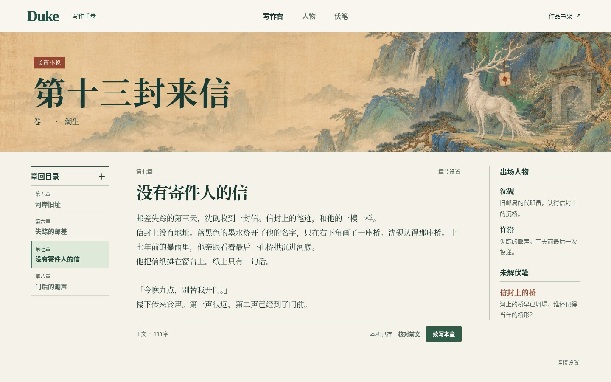

# 山海手卷

山海手卷是一个可以自托管的中文长篇小说写作台。打开一章，左手是目录，右手是已经出场的人物和仍未解开的伏笔。你可以从上一句接着写，也可以让小说协作编辑读过前情，再给出一段候选续文。



[查看手机端写作台](docs/images/shanhai-mobile.jpg)

## 从一封来信开始

第一次打开会看到示例小说《第十三封来信》。沈砚收到了一封没有寄件人的信，信封上画着一座早已坍塌的桥。用这一章就能试完一次写作流程。

1. **写章回。** 在正文中接着写，或从「作品书架」新建自己的小说。「章节设置」可以改章名、记提要。桌面上用左侧目录切章，手机上用正文上方的章节选择器。
2. **记人物和伏笔。** 在「人物」里记录身份、动机、顾虑、关系和首次出场章。在「伏笔」里给线索指定埋下和回收的章回。回到前面的章节，右侧只列出当时已出场的人物和当时未解的伏笔。
3. **核对或续写。** 配置模型后，点「核对前文」查找叙事矛盾，或用「续写本章」提出要求，例如“保持沈砚的视角，让他先认出桥，再决定是否开门”。编辑会参考当前正文、此前章回的节选和此时可见的设定。只有点「接到正文末尾」，续文才进入手稿。
4. **带走手稿。** 正文、提要和设定会在当前浏览器中自动保存。打开「作品书架 → 导出当前手稿」即可下载整本纯文本，包含章节、人物和伏笔。

## 在本机打开

需要 Python 3.10 或更高版本。在项目根目录运行以下命令。

```bash
python3 -m venv .venv
.venv/bin/python -m pip install -e .
.venv/bin/duke-agent-fabric --host 127.0.0.1 --port 9090
```

打开 [本机写作台](http://127.0.0.1:9090)。手写、整理设定和导出都可以直接使用。书架按站点、浏览器和当前身份区分；升级时沿用原地址和身份即可继续编辑。换设备或清理浏览器数据前，请先导出需要的手稿。

## 接入小说协作编辑

要使用续写和前文核对，请在启动服务的终端设置一个可访问的 OpenAI 兼容模型网关。下面的地址和模型名是示例，请换成自己的配置。

```bash
export DUKE_MODEL_API_BASE='http://127.0.0.1:8000/v1'
export DUKE_MODEL_NAME='your-served-model'
read -rs -p '网关 API 密钥：' DUKE_MODEL_API_KEY
export DUKE_MODEL_API_KEY
.venv/bin/duke-agent-fabric --host 127.0.0.1 --port 9090
```

重启服务后，可在页尾「连接设置」确认模型状态。调用 AI 时，当前请求使用的作品节选与相关设定会提交到服务端和所配网关。作品书架保存在浏览器的 IndexedDB 中，服务端运行记录和浏览器原稿分别存储。[模型配置](docs/model-gateway.md) · [存储说明](docs/storage.md)

## 开发与部署

写作界面与上下文选取逻辑在 `prototype/`，小说协作编辑的职责和提示词在 `config/agents.json`，API 在 `src/duke_harness/`。从源码运行时，仓库名和启动命令均沿用 `duke-agent-fabric`。

```bash
.venv/bin/python -m pip install -e '.[dev,production]'
make test
make lint
```

`make test` 同时运行 Python 测试与小说上下文测试，后者需要 Node.js 18 或更高版本。多人部署可使用 OIDC 身份、独立模型网关与服务端存储。[API 说明](docs/api.md) · [自托管部署](deploy/single-host/README.md) · [Apache 2.0 许可证](LICENSE)
